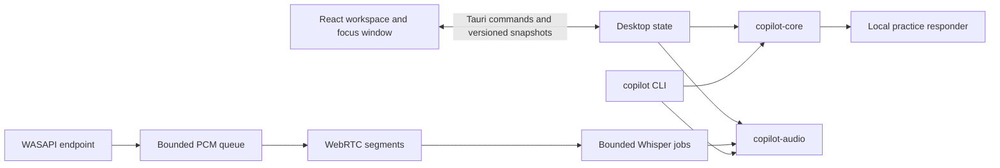

# Current architecture

Baseline B is `d2d806937b2b8ca31761fdf2d744d725927f1a7a` on Windows x64. `personal_copilot.7z` has SHA-256 `8eb036422e2517af731635626b51e57093df50d7465b4d273ca49f4ee944d508` and records the same main ref. The 79 tracked files extracted from the archive matched the checkout byte for byte. Extraction selected regular tracked files from the archive and omitted its Git metadata, user files, tools, model, and build output. The source is in `benchmarks/output/baseline-3.0/archive/personal_copilot` locally.

Line references here and in the technical-debt audit refer to the baseline. Use `git show d2d8069:<file>` or the extracted copy for that source. [Current runtime architecture](../architecture/DESKTOP_3_0.md).

| Boundary | Owner | Behavior |
| --- | --- | --- |
| Desktop presentation | [main.tsx](../../apps/desktop/src/main.tsx#L23), [components.tsx](../../apps/desktop/src/components.tsx#L29), [audio-setup.tsx](../../apps/desktop/src/audio-setup.tsx#L8) | React views, capture consent, manual input, focus companion, settings stored in WebView local storage. |
| Commands and events | [main.rs](../../apps/desktop/src-tauri/src/main.rs#L11), [workspace.rs](../../apps/desktop/src-tauri/src/workspace.rs#L332), [protocol.ts](../../apps/desktop/src/protocol.ts#L77) | Tauri commands mutate one desktop session. Monotonic snapshot updates let the renderer discard stale delivery. |
| Capture and ASR | [windows.rs](../../crates/copilot-audio/src/windows.rs#L106), [pipeline.rs](../../crates/copilot-audio/src/pipeline.rs#L186), [whisper.rs](../../crates/copilot-audio/src/whisper.rs#L37) | WASAPI shared mode converts to 16 kHz PCM. Per-endpoint channel downmix, WebRTC VAD, bounded frame and decode queues, checksum-pinned CPU Whisper. |
| Transcript and answer lifecycle | [session.rs](../../crates/copilot-core/src/session.rs#L187), [boundary.rs](../../crates/copilot-core/src/boundary.rs), [protocol.rs](../../crates/copilot-core/src/protocol.rs) | Ordered provisional and final revisions. Final text drives grouping. Answer keys bind session, question, and revision. Checked answers are retained in bounded memory. |
| Answer provider | [workspace.rs](../../apps/desktop/src-tauri/src/workspace.rs#L214), `rehearsal.rs` (since removed) | Bundled deterministic practice responder. Rust desktop has no cloud login, key storage, or network inference. |
| CLI | [main.rs](../../apps/cli/src/main.rs), [audio.rs](../../apps/cli/src/audio.rs) | Reuses the domain and optional native audio crates for JSON replay, endpoint discovery and paced WAV replay. |
| Package | [tauri.conf.json](../../apps/desktop/src-tauri/tauri.conf.json), [preview.yml](../../.github/workflows/preview.yml), [installer-smoke.ps1](../../apps/desktop/tests/installer-smoke.ps1) | Private Windows NSIS preview. Native WebView2 and controlled install tests exist. |
| Legacy | [app.py](https://github.com/Jigsaw777/OpenKeet/blob/769f9023f888ef8b9a19270f5b9fcf3758d1a8bd/app.py#L56), [providers.py](https://github.com/Jigsaw777/OpenKeet/blob/769f9023f888ef8b9a19270f5b9fcf3758d1a8bd/providers.py#L63), [core.py](https://github.com/Jigsaw777/OpenKeet/blob/769f9023f888ef8b9a19270f5b9fcf3758d1a8bd/core.py#L76) | Archived Python/Tkinter launchers, local Ollama, CLI processes, JSON profile and document import. |

The baseline opens one microphone **or** one loopback route. There is no simultaneous dual-route contract. Recognition runs off the WebView thread but in the desktop process. Stopping drains the workers. Pause is implemented as a stop followed by a fresh model load on resume. Session history is process-local.
